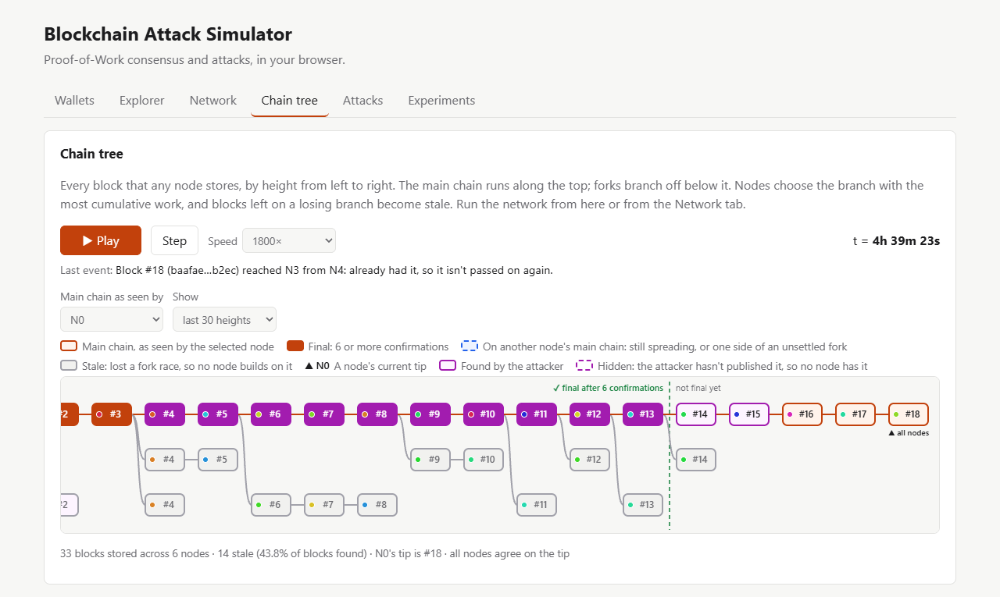
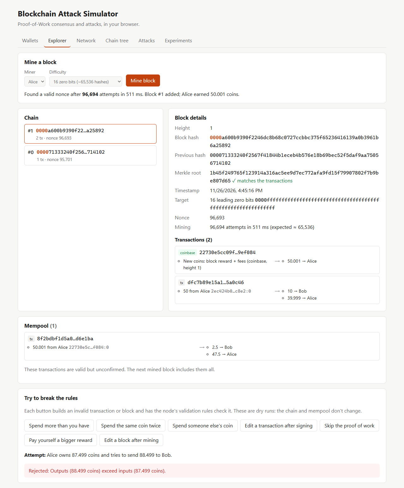
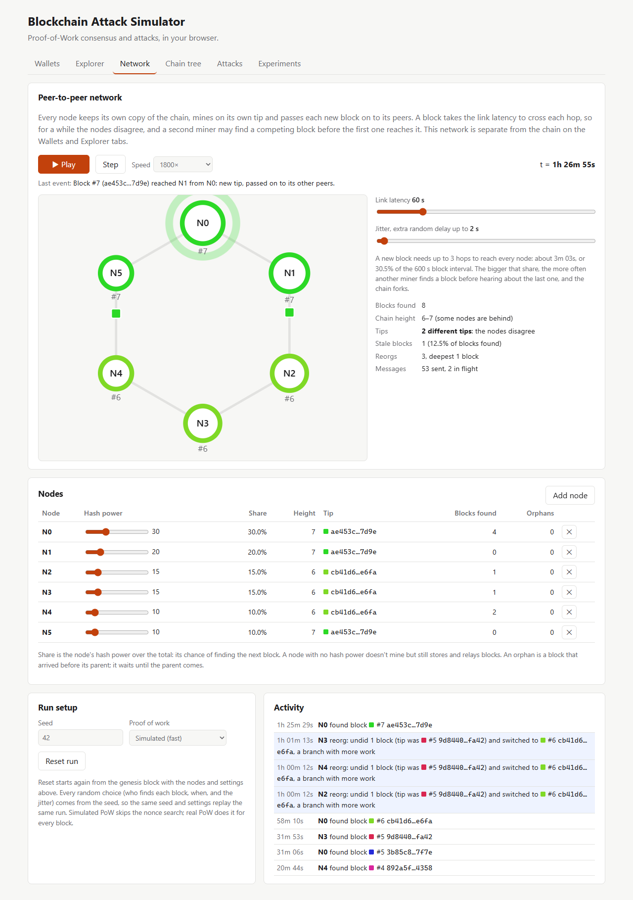
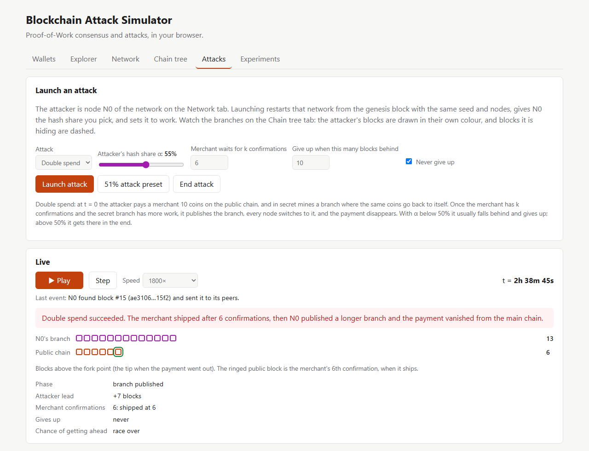
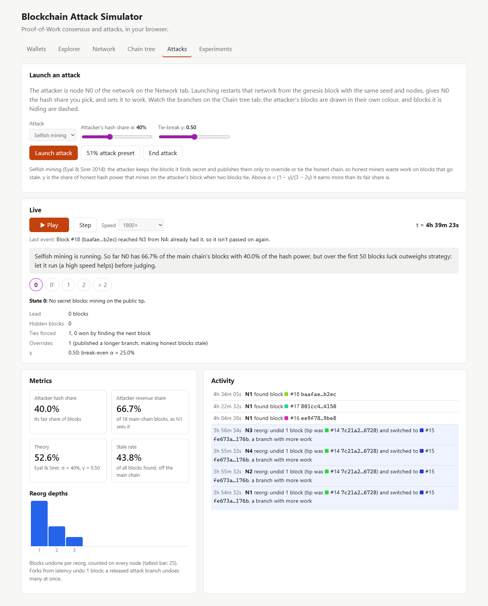
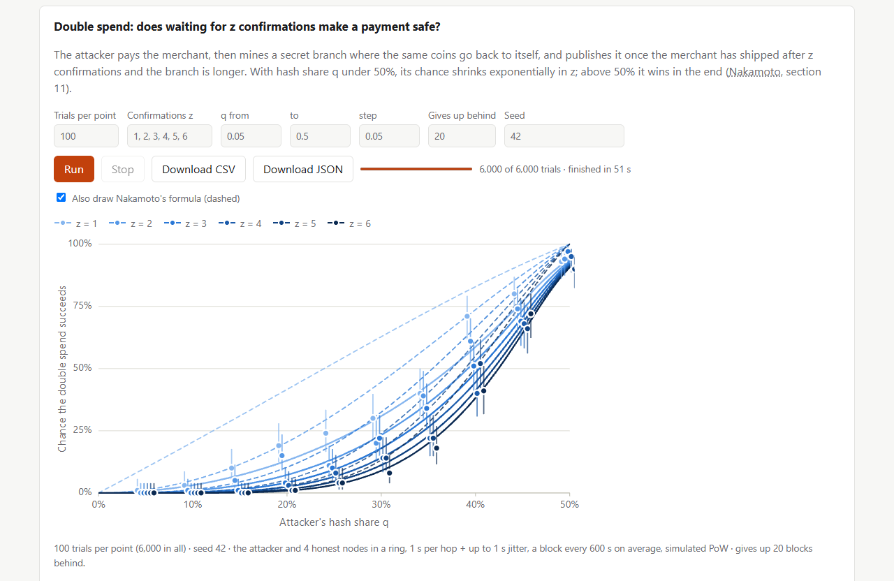
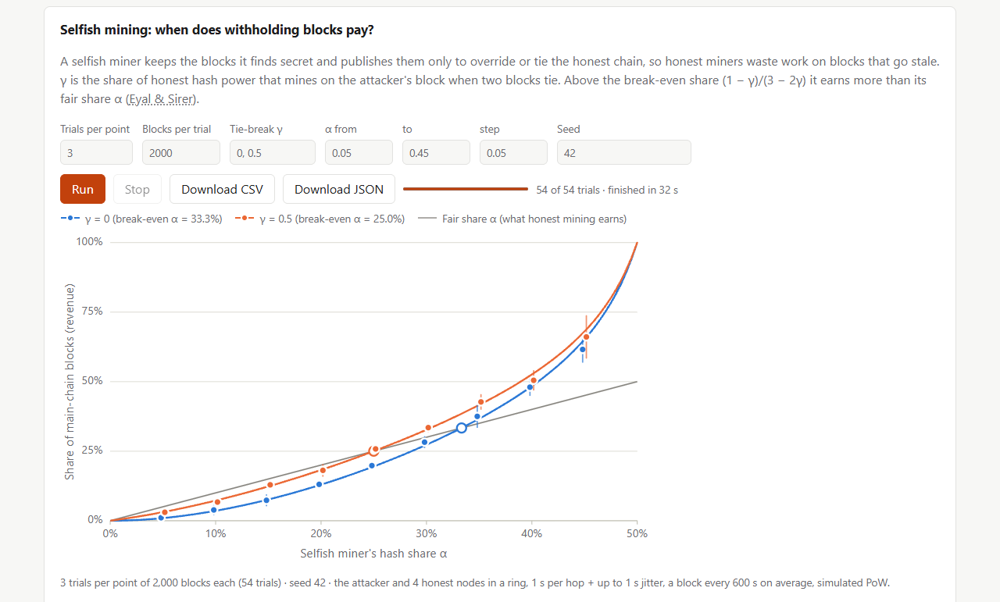
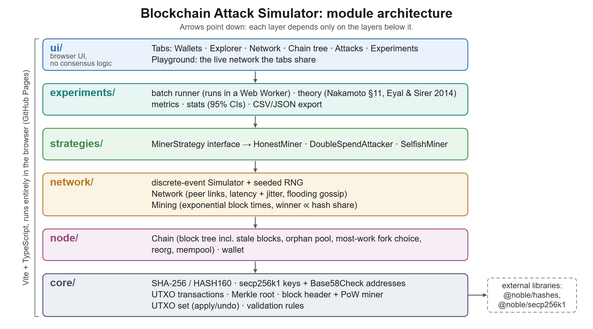

# Blockchain Attack Simulator

An interactive, browser-only simulator of a small Bitcoin-style Proof-of-Work network. You can watch blocks get mined and gossiped and see forks resolve, then launch a **double-spend / 51% attack** or **selfish mining** and see how the chain reacts. An experiment mode runs thousands of trials and plots the results against the published theory (Nakamoto 2008 §11; Eyal & Sirer 2014). CSCI2730 course project.

**Live demo:** https://riskypork.github.io/blockchain-attack-simulator/
&nbsp;·&nbsp; **[User guide](docs/USER_GUIDE.md)**



## Features

| Tab | What you can do |
|---|---|
| **Wallets** | Generate secp256k1 key pairs with real Bitcoin-style addresses (Base58Check of HASH160), see confirmed and pending balances and the individual UTXOs, and send signed transactions. |
| **Explorer** | Mine blocks with **real SHA-256 proof of work** (8–22 leading zero bits), inspect each block's header, Merkle root and transactions, and try seven "break the rules" demos (overspend, double spend, stolen coin, tampered tx, fake PoW, inflated reward, tampered block) to see which validation rule rejects each one. |
| **Network** | Run a peer-to-peer network of 1–12 nodes on a ring. Set each node's hash power, the link latency and jitter, the seed, and the PoW mode (simulated or real). Blocks animate along the links, and nodes are coloured by their tip, so a fork shows up as two colours. |
| **Chain tree** | See every block any node stores: the main chain, stale branches, each node's tip, the "final after 6 confirmations" line, and the attacker's published and hidden blocks. |
| **Attacks** | Launch a double spend (choose α, k confirmations and the give-up distance), the one-click 51% preset, or selfish mining (α, γ). A live readout shows the private-vs-public race, the selfish miner's state machine, revenue share against theory, the stale rate and a reorg-depth histogram. |
| **Experiments** | Run thousands of headless trials in a Web Worker and chart the simulated success rate and revenue (with 95% CIs) against the closed-form theory. Download the results as CSV or JSON, with the seed and every setting included, so any run can be reproduced. |

## Getting started

Use the live demo, or run it locally. Local runs need **Node.js 22.12 or newer** (Vitest 5 requires it; CI uses Node 24).

```bash
npm install
npm run dev        # dev server at http://localhost:5173/blockchain-attack-simulator/
npm test           # 654 unit tests (Vitest)
npm run build      # type-check, then build to dist/
npm run preview    # serve the production build locally
```

There is no backend. Everything, including the crypto and the batch experiments, runs in the browser. Every push to `main` is tested, built and deployed to GitHub Pages by [`.github/workflows/deploy.yml`](.github/workflows/deploy.yml).

New here? The [user guide](docs/USER_GUIDE.md) walks through each tab with a short guided tour.

## Screenshots

| | |
|---|---|
|  |  |
| **Explorer:** real PoW, block details, rejected overspend | **Network:** high latency → competing tips and reorgs |
|  |  |
| **51% attack:** the private branch wins after 6 confirmations | **Selfish mining:** state machine, revenue vs theory |
|  |  |
| **Experiment 1:** double-spend success vs q, z = 1…6 | **Experiment 2:** selfish revenue vs α, γ = 0 and 0.5 |

## Reproducing the experiment charts

1. Open the **Experiments** tab and leave every field at its default (seed 42, 4 honest nodes, 1 s latency + up to 1 s jitter, 600 s block interval).
2. Press **Run** on both cards. On a laptop the double-spend sweep (60 cells × 100 trials) takes about a minute and the selfish-mining sweep (18 cells × 3 trials × 2,000 blocks) about 30 s.
3. Press **Download CSV / JSON**. The same seed and settings always give the same numbers, bit for bit. Each trial's seed is derived from the experiment seed, the cell and the trial number, so the result doesn't depend on how the work was chunked.

With the defaults, the exact theory value falls inside the simulated 95% interval in **57 of 60** double-spend cells and **17 of 18** selfish-mining cells. That is in line with what a 95% interval should give (about 1 miss in 20). The simulated selfish miner beats its fair share above α ≈ 1/3 when γ = 0 and above α ≈ 1/4 when γ = 0.5, as the paper predicts.

## Architecture



Each layer only uses the layers below it, and the UI holds no consensus logic: it reads state and dispatches user actions.

```
src/
  core/         consensus rules and crypto, no notion of a network
    hash.ts           SHA-256, double SHA-256, HASH160
    keys.ts           secp256k1 key pairs, ECDSA, Base58Check addresses
    transaction.ts    UTXO-model txs, txid = sha256d(serialised tx), per-input signatures, coinbase
    merkle.ts         Merkle root (last hash duplicated on odd levels)
    block.ts          header (prevHash, merkleRoot, timestamp, nonce, target), block hash, work
    miner.ts          nonce search in chunks (UI never freezes), block assembly, subsidy + fees
    utxo.ts           UTXO set with applyBlock / undoBlock (exact inverses, used by reorgs)
    validation.ts     every tx and block rule, each with a human-readable rejection reason
  node/         one node's view of the chain
    blocktree.ts      every block incl. stale ones, orphan pool, cumulative work
    chain.ts          fork choice by most cumulative work (ties: first seen), reorgs, mempool, confirmations
    wallet.ts         coin selection and payment building
  network/      the simulated peer-to-peer network
    simulator.ts      discrete-event engine (min-heap of timestamped events, simulated clock)
    rng.ts            seeded mulberry32 RNG + exponential draws
    network.ts        nodes, links with latency + jitter, flooding gossip, sync on connect
    mining.ts         block times ~ Exp(1/interval), winner ∝ hash share; simulated or real PoW
  strategies/   miner behaviours behind one MinerStrategy interface
    honest.ts         build on the most-work tip, publish at once (γ tie-break for selfish experiments)
    double-spend.ts   pay the merchant, mine a private branch, release after k confirmations
    selfish.ts        Eyal & Sirer's state machine (0, 0′, 1, 2, >2)
  experiments/  batch trials and the theory they are checked against
    batch.ts          trial runners and round-robin parameter sweeps
    theory.ts         Nakamoto §11, exact success for this attacker, Eyal & Sirer revenue + threshold
    metrics.ts        revenue share, stale rate, reorg-depth histogram
    stats.ts          Wilson and mean 95% intervals
    export.ts         CSV / JSON export with the seed and settings
    worker.ts         Web Worker entry for the Experiments tab
  ui/           one file per tab, plus the playground (the live network the tabs share)
docs/
  USER_GUIDE.md     how to use every tab
  SPRINT_PLAN.md    the project's Scrum-style plan
```

Tests sit next to the code they cover (`*.test.ts`, 26 files, 654 tests). They include the Bitcoin wiki address vector, the whitepaper's table (q = 0.1, z = 5 → 0.0009137), apply/undo inverse property tests, reorg cases, and same-seed determinism of the event log.

### Key design choices

- **Two mining modes.** *Real PoW* searches nonces until `sha256d(header) ≤ target`, so every block is genuinely valid. *Simulated PoW* (Fast mode) uses difficulty 0 and draws block times from the exponential distribution, the same Poisson process real mining produces. That makes thousands of trials feasible, and every node still validates every block.
- **Most cumulative work, not height.** Fork choice compares the summed work of each branch. On a tie, a node keeps the block it saw first, as Bitcoin Core does (selfish mining depends on this rule).
- **Reproducible runs.** All randomness comes from one seeded RNG per run, and events at the same time fire in FIFO order. The same seed and settings replay the same run, in the live tabs and in experiments alike.
- **Theory you can trust.** Besides Nakamoto's formula, `theory.ts` computes the exact success probability for *this* attacker (it needs to get strictly ahead, it counts the payment's own block as the first confirmation, and it gives up a set distance behind). The charts show both curves.

## Tech

Vite + TypeScript, no framework and no backend · [@noble/hashes](https://github.com/paulmillr/noble-hashes) (SHA-256, RIPEMD-160) · [@noble/secp256k1](https://github.com/paulmillr/noble-secp256k1) (ECDSA) · Vitest · hand-written SVG for the graphs and charts · GitHub Actions → GitHub Pages

## References

- S. Nakamoto, *Bitcoin: A Peer-to-Peer Electronic Cash System*, 2008, §11 "Calculations".
- I. Eyal and E. G. Sirer, *Majority is not Enough: Bitcoin Mining is Vulnerable*, Financial Cryptography 2014.

## License

MIT
