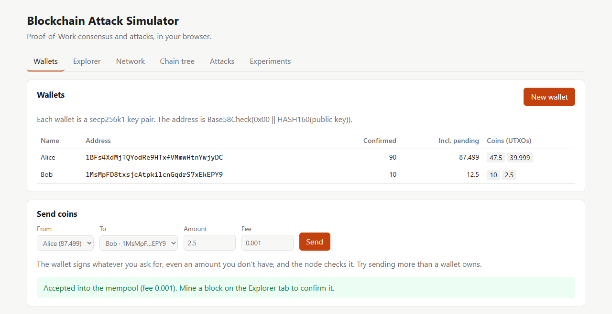
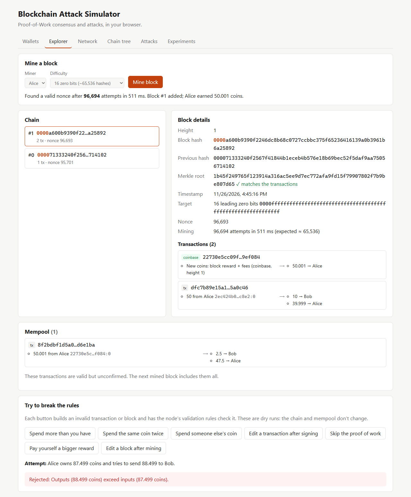
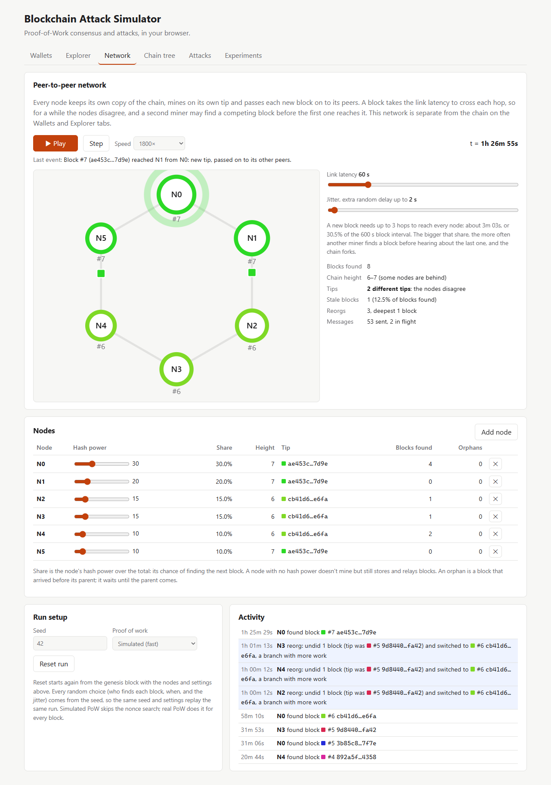
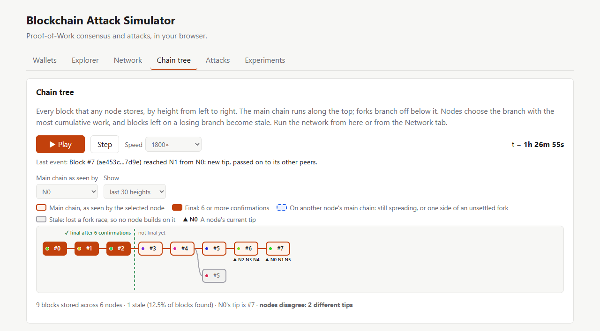
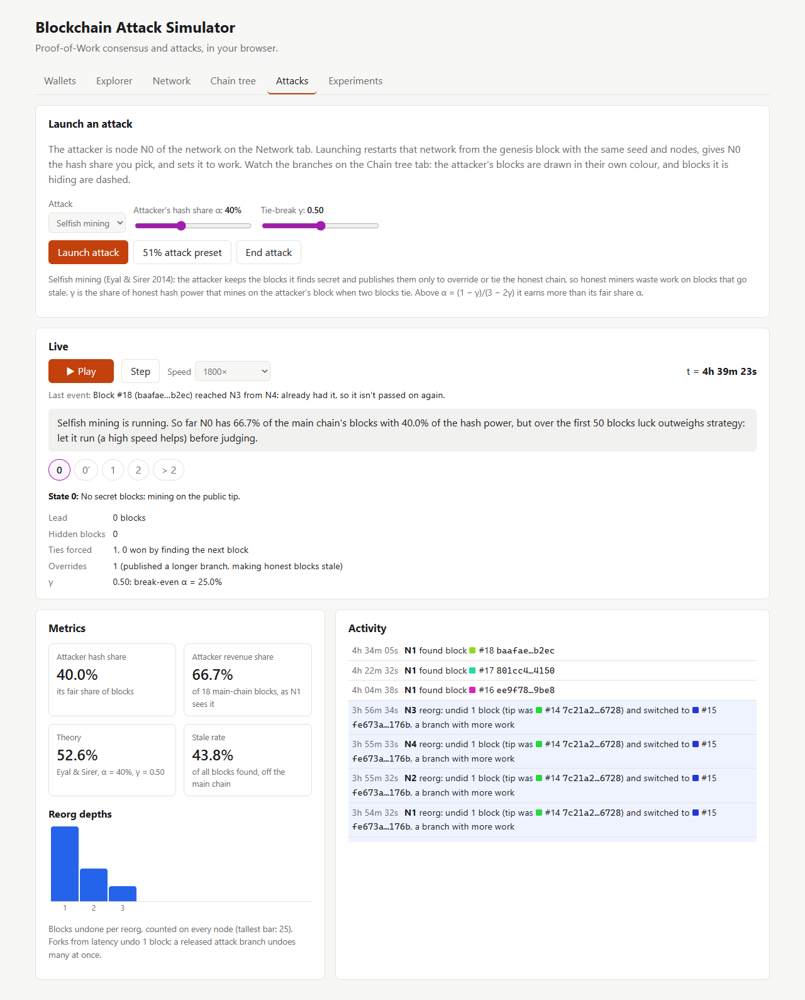
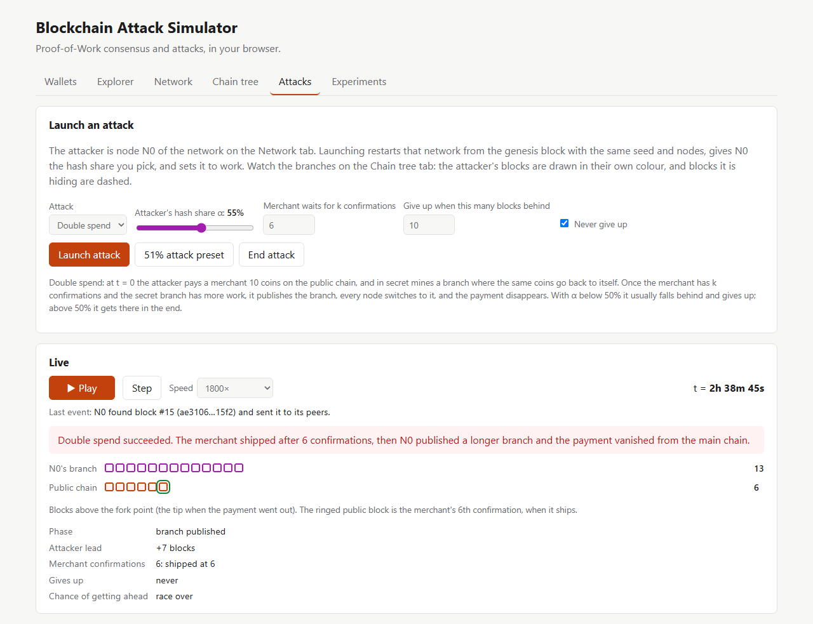
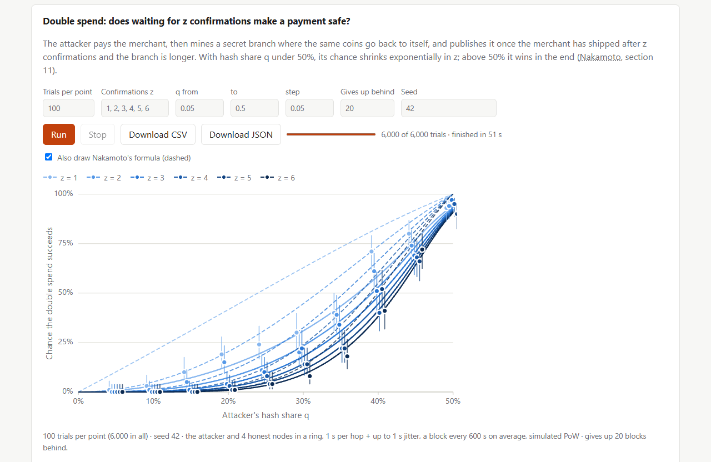
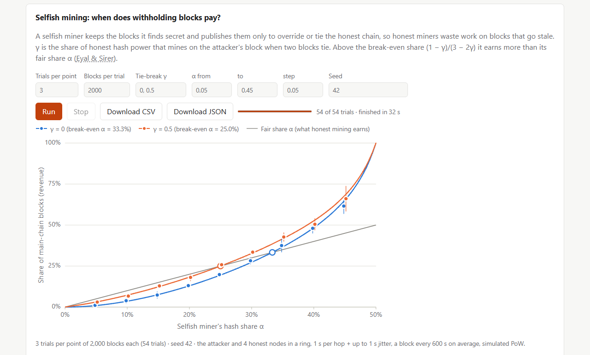

# User guide

This guide covers every tab of the Blockchain Attack Simulator, with short guided tours. Open the [live demo](https://riskypork.github.io/blockchain-attack-simulator/), or run `npm run dev` (see the [README](../README.md)).

- [The two worlds: a single chain and a network](#the-two-worlds-a-single-chain-and-a-network)
- [Wallets](#wallets)
- [Explorer](#explorer)
- [Network](#network)
- [Chain tree](#chain-tree)
- [Attacks](#attacks)
- [Experiments](#experiments)
- [Guided tours](#guided-tours)
- [Glossary](#glossary)
- [Troubleshooting](#troubleshooting)

## The two worlds: a single chain and a network

The app holds two separate blockchains:

| | Single chain | Peer-to-peer network |
|---|---|---|
| Tabs | **Wallets**, **Explorer** | **Network**, **Chain tree**, **Attacks** |
| Nodes | one | 1–12, each with its own copy of the chain |
| Mining | you press *Mine block*; real SHA-256 PoW | automatic, on a simulated clock; simulated or real PoW |
| Good for | keys, transactions, block structure, validation | latency, forks, reorgs, attacks |

The **Experiments** tab builds its own fresh networks for every trial and doesn't touch either of these.

Every tab keeps its state when you switch away, so a running network or a half-filled form is still there when you come back. Reloading the page starts everything again.

---

## Wallets

**New wallet** creates a secp256k1 key pair and names it (Alice, Bob, Carol, …). The table shows each wallet's:

- **Address**: Base58Check(0x00 ‖ HASH160(public key)), the same format as a Bitcoin P2PKH address. Hover over it to see the public key.
- **Confirmed**: coins in mined blocks.
- **Incl. pending**: the balance once the mempool's transactions are mined as well.
- **Coins (UTXOs)**: the individual unspent outputs the wallet owns. Hover over one to see its `txid:index`.

**Send coins** builds and signs a transaction. Pick *From*, *To* (or *Other address…* to type one), *Amount* and *Fee*, then press **Send**. The wallet picks enough of the sender's coins, pays the recipient and sends the change back to the sender.

The wallet signs whatever you ask for, even an amount it doesn't have. The **node** decides whether the transaction is valid: if it is, it goes into the mempool (green banner); if not, the banner names the rule it broke (for example *"Outputs (88.499 coins) exceed inputs (87.499 coins)"*). A new wallet owns nothing until it mines a block or someone pays it.

## Explorer

### Mine a block

Choose the **Miner** (the wallet that gets the reward) and a **Difficulty** of 8–22 leading zero bits, then press **Mine block**. The miner searches nonces until `sha256d(header) ≤ target`, which takes about 2^bits attempts: 16 bits (the default) is roughly 65,000 hashes and under a second. The status line shows nonces tried, hashes per second and the time taken. **Cancel** stops a long search.

The first block mined is the genesis block. Every block pays its miner a coinbase of **50 coins plus the fees** of the transactions it includes, and the next block takes every valid transaction in the mempool.

### Chain and block details

Click any block in the **Chain** list to inspect it:

- height, **block hash** (leading zeros highlighted: they are what the PoW pays for), previous hash
- **Merkle root**, with a ✓ when it matches the block's transactions
- timestamp, **target** (as leading zero bits and in full), **nonce**, and the attempts and time it took
- every transaction, with where its coins came from and where they go

**Mempool** lists valid transactions that are waiting for a block.

### Try to break the rules

Each button builds something invalid and has the node's validation rules judge it. These are dry runs: the chain and the mempool don't change.

| Button | What it attempts | Rejected because |
|---|---|---|
| Spend more than you have | outputs larger than inputs | Σ outputs > Σ inputs |
| Spend the same coin twice | a second payment from an already-spent output | input already spent |
| Spend someone else's coin | a thief signs with the wrong key | the key doesn't match the output's address |
| Edit a transaction after signing | the amount is changed without re-signing | invalid signature |
| Skip the proof of work | a block whose hash misses the target | PoW doesn't meet the target |
| Pay yourself a bigger reward | a mined block whose coinbase claims 1000 extra coins | coinbase > subsidy + fees |
| Edit a block after mining | a transaction is changed after the nonce is found | Merkle root mismatch |

The transaction demos need a wallet that owns coins (mine a block first). The block demos need at least one wallet.

## Network

A simulated peer-to-peer network. It starts with six nodes (N0–N5) on a ring with hash powers 30, 20, 15, 15, 10 and 10, a 10 s link latency, up to 2 s of jitter, and one block every 600 s on average (as in Bitcoin).

### Running the clock

| Control | Effect |
|---|---|
| **▶ Play / ❚❚ Pause** | runs the simulated clock |
| **Step** | fires exactly one event (a block being found, or a block reaching a node), then pauses. The line below says what happened. |
| **Speed** | simulated seconds per real second, from 1× to 1800×. At 600× a 600 s block interval passes in about one second. |
| **t =** | the simulated time |

The Network, Chain tree and Attacks tabs share these controls and the same network, so any of them can pause the run.

### The graph

Nodes sit on a ring, and each node links to its two neighbours. A node's **size** grows with its hash share, and its **colour** is the colour of the block at its tip, so nodes that agree share a colour and a fork shows up as two. A node pulses when it finds a block. Small squares are **blocks in flight**, moving along a link in the block's colour.

### Settings

- **Link latency** (0–300 s) and **Jitter** (extra random delay, 0–120 s) apply to every link at once. The note below them estimates how long a block takes to reach every node, as a share of the block interval. The bigger that share, the more forks you get.
- **Nodes table:** drag a node's **Hash power** slider (0–100; only the ratios matter). *Share* is that node's chance of finding the next block. A node with 0 hash power still stores and relays blocks. **Add node** (up to 12) and **✕** (remove) reshape the ring while it runs. *Orphans* counts blocks waiting for a parent the node hasn't received.
- **Run setup:** set the **Seed** and the **Proof of work** mode, then press **Reset run** to start again from genesis. *Simulated (fast)* skips the nonce search; *Real SHA-256, 12 zero bits* does it for every block (about 4,096 hashes each). The same seed and settings replay exactly the same run.

### Stats and activity

The stats list shows blocks found, chain height on each node, whether all nodes agree on the tip, **stale blocks** (and their share of all blocks), **reorgs** (with the deepest), and messages sent and in flight. **Activity** logs found blocks and every reorg: which node undid how many blocks, and the tip it switched to.

## Chain tree

Every block that any node stores, by height from left to right. The main chain runs along the top, and forks branch off below it.

- **Main chain as seen by** picks whose view to draw: nodes can disagree while a block is still spreading.
- **Show** limits the view to the last 30, 60 or 150 heights, or shows every height.
- The legend: main chain (outlined), **final** (6 or more confirmations, filled), on another node's main chain (blue dashed), **stale** (grey), **▲ N0** a node's tip, plus during an attack **found by the attacker** (purple) and **hidden** (purple dashed: withheld, so no node has it yet). A dashed green line marks where finality starts.
- Click a block to see its details below the tree.

## Attacks

The attacker is always node **N0** of the network. **Launch attack** restarts the network from genesis with the same nodes, seed and link settings, gives N0 the hash share α you chose, and splits the remaining 1 − α among the honest nodes in the ratio they had. The run starts playing at once. **End attack** restarts with every node honest. An attack needs at least two nodes.

### Double spend

At t = 0 the attacker (who owns the 50-coin genesis reward) pays a merchant **10 coins** on the public chain. In secret it mines a branch from the same parent in which those coins go back to itself. Once the payment has **k confirmations** and the secret branch has strictly more work, it publishes the branch. Every node reorganises to it, and the payment disappears: the merchant shipped and was never paid.

| Setting | Meaning |
|---|---|
| Attacker's hash share α | 5–95% |
| Merchant waits for k confirmations | 1–30 (6 is Bitcoin's rule of thumb) |
| Give up when this many blocks behind | the attacker writes its branch off this far behind (1–100) |
| Never give up | the attacker keeps going however far behind it falls |

The **Live** card shows the outcome banner (pending, succeeded or failed) and a race picture: the attacker's branch against the public chain above the fork point, with the merchant's k-th confirmation ringed. Below it are the phase, the lead, the merchant's confirmations, and the chance (from theory) that the attacker ever gets ahead from where it stands.

**51% attack preset:** a double spend with α = 55%, k = 6, never giving up. With more than half of the hash power the race drifts the attacker's way, so it succeeds in the end, however many confirmations the merchant waits for.

### Selfish mining

The attacker withholds the blocks it finds and publishes them only to override or tie the honest chain, so honest miners waste work on blocks that end up stale.

- **α**: the attacker's hash share.
- **Tie-break γ** (0–1): when the attacker publishes a block that ties the public chain, the share of honest hash power that mines on the attacker's block.

The state machine chips show where the attacker is: **0** (no secret blocks), **0′** (a tie race), **1** and **2** (blocks ahead), **> 2** (well ahead). The stats show the lead, hidden blocks, ties forced and overrides. The **Metrics** tiles compare the attacker's **revenue share** (its share of main-chain blocks) with its hash share and with the Eyal & Sirer **theory**, and show the **stale rate**. The **Reorg depths** histogram counts blocks undone per reorg. Forks caused by latency undo 1 block; a released attack branch undoes several at once.

Selfish mining pays above α = (1 − γ)/(3 − 2γ): **33.3%** at γ = 0 and **25%** at γ = 0.5. Revenue is noisy over the first 50 or so blocks, so let it run at a high speed before judging. For numbers close to the theory, set the latency on the Network tab to 1–2 s first: the formula assumes blocks reach everyone at once.

## Experiments

Runs many headless trials, each a full network run from genesis (every block validated and gossiped by every node; only the nonce search is skipped), in a background Web Worker, and charts them against the theory.

**Network settings** at the top apply to both experiments: honest nodes (1–11, sharing the honest hash power equally), latency, jitter and block interval. The formulas assume no network delay, so keep the latency small next to the block interval when comparing with theory.

### Experiment 1: double spend

*Does waiting for z confirmations make a payment safe?* Set **trials per point** (up to 10,000), the **confirmations z** to try (up to 6 values, e.g. `1, 2, 3, 4, 5, 6`), a range of attacker shares **q** (from / to / step), the **give-up** distance and the **seed**.

- **Solid lines:** the exact chance of success for this simulator's attacker. It must get strictly ahead, it counts the payment's own block as the first confirmation, and it gives up a set distance behind.
- **Dashed lines** (tick *Also draw Nakamoto's formula*): the whitepaper's §11 formula, which counts a tie as a win and never gives up, so it sits a little higher.
- **Dots:** the simulated success rate, with a 95% Wilson interval.

### Experiment 2: selfish mining

*When does withholding blocks pay?* Set **trials per point**, **blocks per trial** (more blocks, less noise), the **γ** values (up to 3), a range of **α** up to 0.5, and the **seed**.

- **Lines:** Eyal & Sirer's expected revenue for each γ, with its break-even point ringed where it crosses the grey **fair share** line (revenue = α, what honest mining earns).
- **Dots:** the selfish miner's share of an honest node's main chain, averaged over the trials, with a 95% interval.

### Running and exporting

**Run** starts the sweep and **Stop** ends it early. Trials run round-robin (trial 1 of every point, then trial 2, …), so a stopped run still covers the whole chart, just with wider error bars. The progress bar shows trials done and the time left. Hover over a dot to see its exact numbers, or open **Table** under the chart.

**Download CSV** gives one row per point: the parameters, trials, successes or mean revenue, the 95% interval, both theory values, the seed and every network setting. **Download JSON** saves the whole experiment, so it can be rerun from that file's settings to get the same numbers.

---

## Guided tours

### 1. A valid and an invalid transaction (3 minutes)

1. **Wallets** → press **New wallet** twice (Alice and Bob).
2. **Explorer** → Miner *Alice* → **Mine block**. Alice now owns 50 coins.
3. **Wallets** → send 10 coins from Alice to Bob. It lands in the mempool, and Bob's *Incl. pending* shows 10.
4. **Explorer** → **Mine block** again. Click block #1: two transactions, the coinbase (50 + 0.001 fee) and Alice → Bob (10 to Bob, 39.999 change to Alice), and a matching Merkle root.
5. Press **Spend more than you have** and **Edit a block after mining** to see two different rules reject the attempts.

### 2. Latency causes forks (3 minutes)

1. **Network** → speed **1800×** → **▶ Play**. With a 10 s latency, the nodes nearly always agree.
2. Drag **Link latency** to **60–120 s**. Watch *Tips* report "2 different tips", nodes in two colours, and reorgs appearing in *Activity*.
3. **Chain tree**: grey stale blocks hang below the main chain. Switch **Main chain as seen by** between nodes during a fork to see that they disagree.
4. Set the latency back to 10 s, and the stale rate drops.

### 3. Double spend: 30% fails, 55% succeeds (3 minutes)

1. **Attacks** → Attack *Double spend*, α **30%**, k **6**, give up at **10** → **Launch attack**, speed 1800×.
2. The private branch usually falls 10 blocks behind and the banner says *Attack failed … the payment stands*. (Try a few seeds on the Network tab; occasionally the attacker gets lucky, as the theory says it should, a little under 10% of the time at k = 6.)
3. Press **51% attack preset**. The attacker eventually overtakes, the banner turns red with *Double spend succeeded*, and the **Chain tree** shows the long purple branch replacing the public one.

### 4. Selfish mining beats its fair share (5 minutes)

1. **Network** → set latency to **1 s** and jitter to **1 s**.
2. **Attacks** → *Selfish mining*, α **40%**, γ **0.5** → **Launch attack**, speed **1800×**.
3. After a few hundred blocks, *Attacker revenue share* settles around the theory value (about 53%), well above the 40% fair share, while the stale rate climbs. On the **Chain tree**, dashed purple blocks are hidden; when they come out, honest blocks go grey.
4. Relaunch with α **20%**: the revenue falls below 20%, because selfish mining below the break-even point loses money.

### 5. Reproduce the report's charts (2 minutes)

**Experiments** → leave every setting at its default → **Run** on both cards → **Download CSV**. With seed 42, the numbers match the ones in the project report exactly.

---

## Glossary

| Term | Meaning here |
|---|---|
| **α / q** | the attacker's share of the total hash power (α for selfish mining, q for a double spend) |
| **γ** | the share of honest hash power that mines on the attacker's block during a tie |
| **k / z** | confirmations: the number of blocks on top of (and including) the block holding a transaction |
| **Confirmation** | a transaction in a main-chain block of height h has (tip height − h + 1) confirmations |
| **Final** | 6 or more confirmations |
| **Fork** | two blocks with the same parent, so nodes may disagree about the tip |
| **Fork choice** | each node follows the branch with the **most cumulative work**; on a tie, the one it saw first |
| **Reorg** | a node undoes blocks back to the fork point and applies a branch with more work. Its transactions go back to the mempool if they are still valid. |
| **Stale block** | a valid block that is not on the main chain: it lost a fork race and its reward is worth nothing |
| **Orphan block** | a block whose parent this node hasn't received yet. It waits in the orphan pool. |
| **Mempool** | valid transactions waiting to be mined |
| **UTXO** | an unspent transaction output: a coin a wallet can spend |
| **Simulated PoW** | difficulty 0: block times are drawn from the exponential distribution instead of being searched for (Fast mode) |
| **Revenue share** | the attacker's share of the main chain's blocks |
| **Stale rate** | stale blocks over all blocks found |
| **Seed** | the number every random choice in a run comes from. The same seed and settings give the same run. |

## Troubleshooting

| Symptom | Why, and what to do |
|---|---|
| **Step** is greyed out | Nothing is scheduled, because no node has hash power. Raise a node's slider. |
| *Mine block* is greyed out | Create a wallet first: the reward needs an address. |
| Mining at 20–22 bits takes long | That is 1–4 million hashes. Press **Cancel**, or pick a lower difficulty. |
| Transaction demos are greyed out | No wallet owns coins yet. Mine a block. |
| Every run looks the same | Runs are seeded. Change the **Seed** on the Network tab (or the experiment's seed) and reset. |
| Selfish-mining revenue is far from the theory | The run is too short, or the latency is high. Run more blocks, or set the latency to 1–2 s. |
| The live run didn't move while the browser tab was in the background | Browsers stop animation frames in background tabs, and each frame counts at most 0.25 s of real time, so the run waits for you instead of jumping ahead. |
| An experiment takes too long | Lower *trials per point* or *blocks per trial*, or press **Stop**: partial results still cover every point. |
| An attack won't launch | It needs at least two nodes. Add one on the Network tab. |
